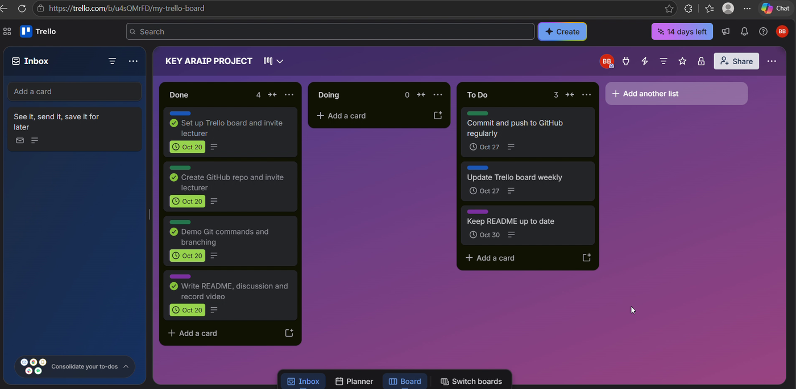
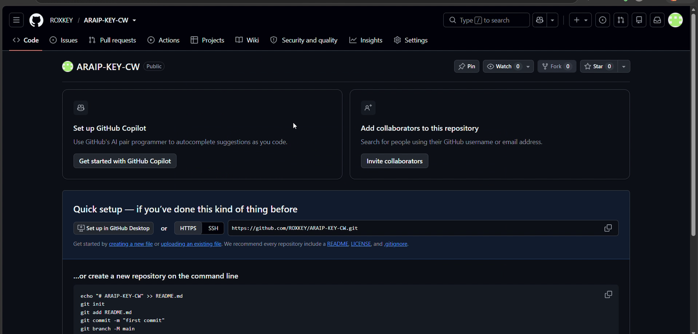
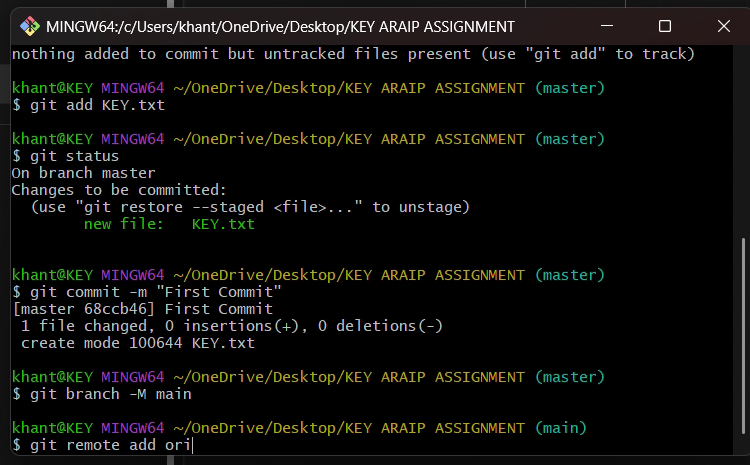
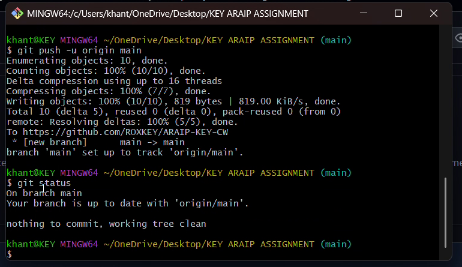
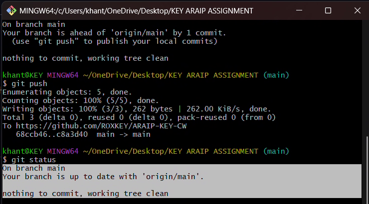
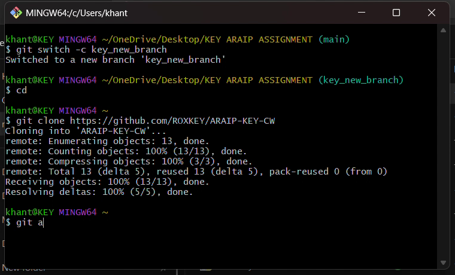
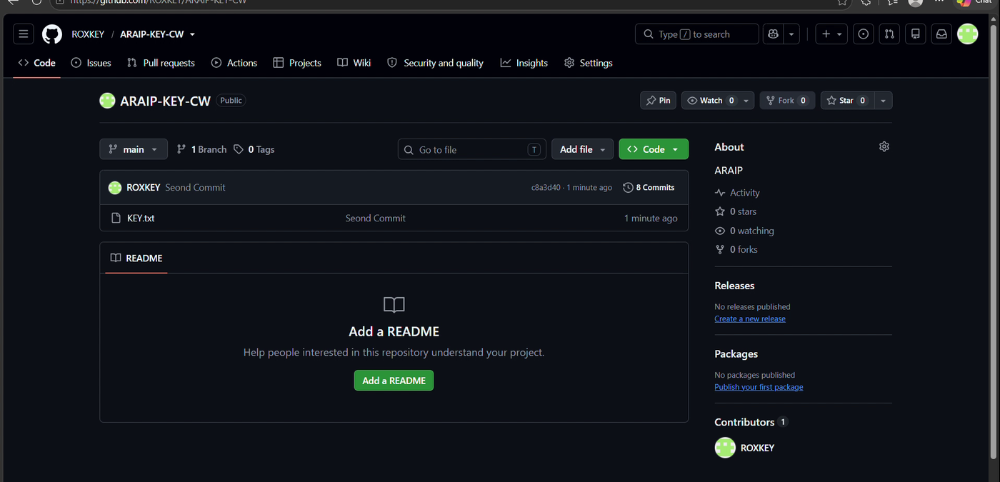

# ARAIP – Applied Robotics and AI Project

University of Hertfordshire · BEng (Hons) Robotics and Artificial Intelligence
Module: Applied Robotics and AI Project (5FTC2068)
Author: **Min Hein Khant** (individual project)

This repository is my workspace for **Assignment 1**. It shows how I use **Git/GitHub** for version control and **Trello** for project management to plan, manage, maintain and back up my project.

**Links**

| Tool | Link |
|---|---|
| GitHub repository | https://github.com/ROXKEY/ARAIP-KEY-CW |
| Trello board | https://trello.com/b/u4sQMrFD/key-araip-project |

The lecturer, Sarina Tajudin (sarina.tajudin@psb-academy.edu.sg), is added as a collaborator on both the repository and the Trello board.

---

## 1. Project management with Trello

Board: **KEY ARAIP PROJECT**

| List | Meaning |
|---|---|
| To Do | Tasks planned but not started |
| Doing | Tasks currently being worked on |
| Done | Finished tasks, ticked complete and archived once finished |

How I use the board:
- Each task is a **card** with a description and a **due date** (yellow when due soon, red when overdue)
- **Labels** colour-code the cards: green = Git, blue = Trello/planning, purple = documentation, orange = evidence
- Cards move between lists by drag-and-drop and are ticked complete when finished
- The link to the related GitHub Pull Request is pasted into the matching card
- **Weekly review:** each week I move cards, tick finished ones, add new tasks and write a short retrospective (what went well, what to improve, what next)



## 2. Version control with Git and GitHub

**Git** is a distributed version control system: every developer has a local repository with the whole history, so I can commit independently. **GitHub** is the cloud service that hosts the shared remote repository for storage, collaboration and backup.

### Setup (one time)

Install Git (https://git-scm.com/download/win), create a GitHub account, then tell Git who you are:

```bash
git config --global user.name "your_github_username"
git config --global user.email "your_github_email"
git config --global --list        # check the settings
```

### Creating the repository

1. Create a new **public** repository called `ARAIP-KEY-CW` on GitHub.
2. In the local project folder, initialise Git, make the first commit and connect to GitHub:

```bash
git init
git add KEY.txt
git commit -m "First Commit"
git branch -M main
git remote add origin https://github.com/ROXKEY/ARAIP-KEY-CW.git
git push -u origin main
```







### Basic workflow: Add, Edit, Commit, Push, Clone

1. **Clone** the repository to your computer
2. **Edit** files in your working folder
3. **Add** the changes you want to the staging area
4. **Commit** the staged changes to your local repository
5. **Push** the commits to GitHub

```bash
git clone https://github.com/ROXKEY/ARAIP-KEY-CW.git   # Clone
# ...edit a file...
git status                                             # see what changed
git add KEY.txt                                        # Add
git commit -m "Second Commit"                          # Commit
git push                                               # Push
```





### Difference between Add, Commit and Push

| Command | What it does | Where it acts |
|---|---|---|
| `git add` | Selects which changes go into the next snapshot | Working folder → **staging area** |
| `git commit` | Saves the staged changes as a snapshot with a unique SHA-1 hash, author, date and message | Staging area → **local repository** |
| `git push` | Uploads the local commits to GitHub | Local repository → **remote repository (GitHub)** |

In short: **add** chooses, **commit** saves locally, **push** shares and backs up. Nothing appears on GitHub until it is pushed.

### Branching strategy

`main` always holds the stable, working version. New work is done on a separate branch so it cannot break `main`, then merged back with a **Pull Request**.

| Branch | Purpose |
|---|---|
| `main` | Stable version of the project |
| `feature/<name>` | New work, e.g. `feature/add-screenshots` |
| `docs/<name>` | README and documentation changes, e.g. `docs/add-readme` |
| `fix/<name>` | Bug fixes |

```bash
git switch -c docs/add-readme          # create and switch to a new branch
git add README.md
git commit -m "Docs: add README"
git push -u origin docs/add-readme     # then open a Pull Request on GitHub and merge
git switch main
git pull                               # bring the merged work back to local main
```

### Commit messages

Short, in present tense, and say what changed, e.g. `Docs: add README`, `Add screenshots`, `Update Trello link`.

### Commit history



Full history: [Commits](https://github.com/ROXKEY/ARAIP-KEY-CW/commits/main) · [Branches](https://github.com/ROXKEY/ARAIP-KEY-CW/branches) · [Pull requests](https://github.com/ROXKEY/ARAIP-KEY-CW/pulls)

## 3. Repository contents

```
ARAIP-KEY-CW/
├── README.md                          # this overview
├── KEY.txt                            # first test file used for the Git demo
├── .gitignore
├── .github/pull_request_template.md   # template used for every Pull Request
└── images/                            # screenshots used in this README
```
